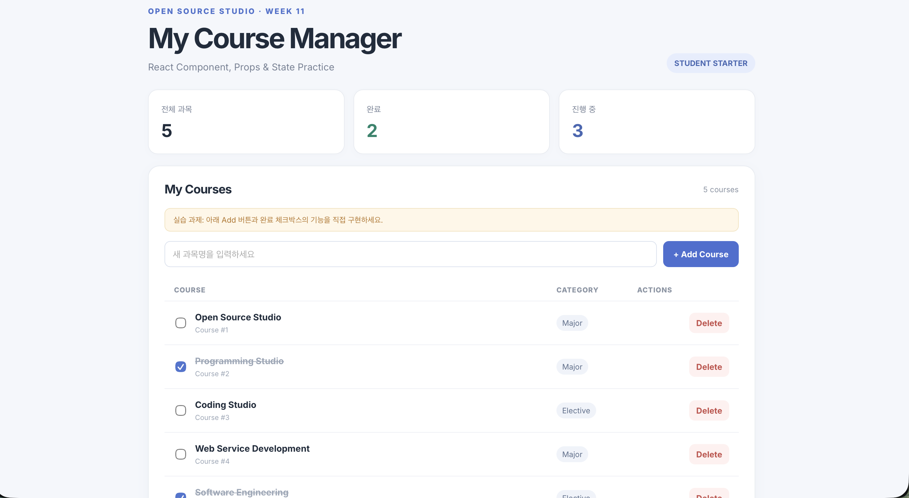
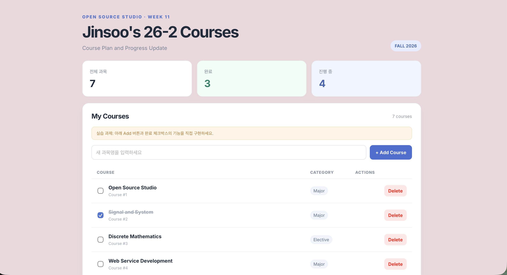
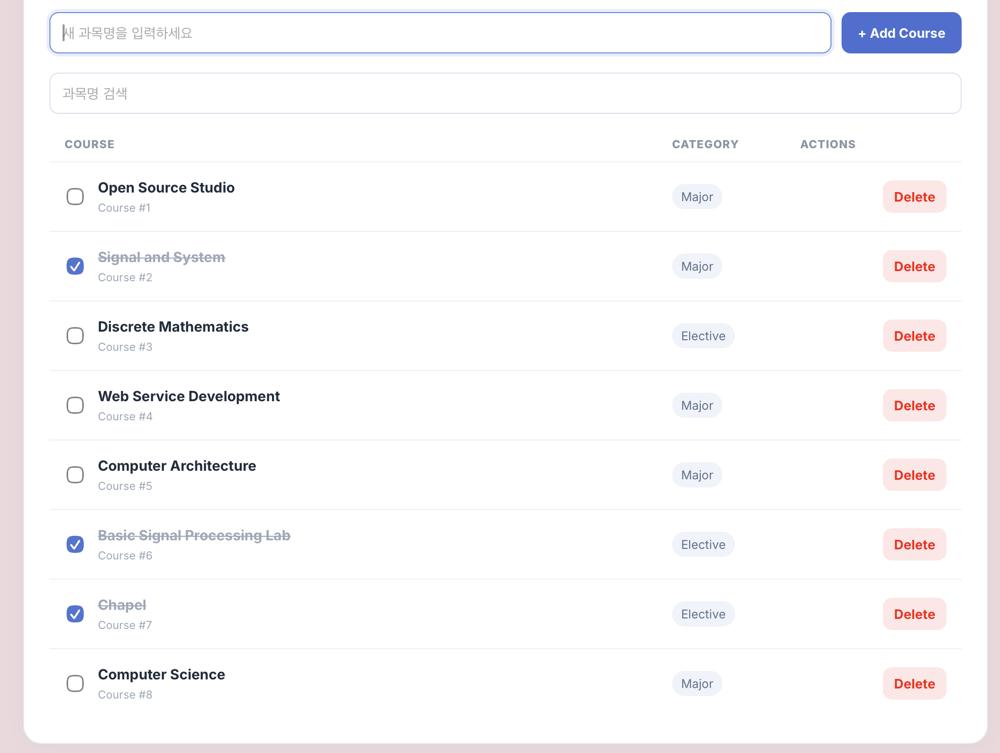
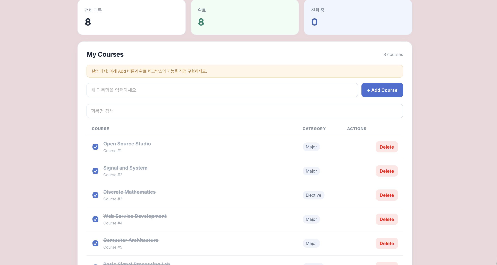
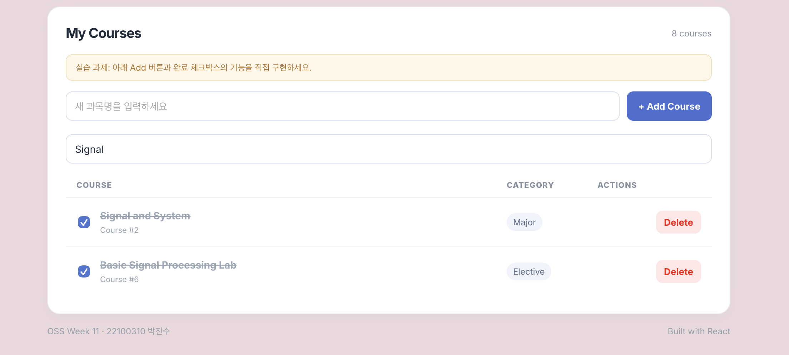

22100310 박진수
# Assignment 11

## Project Information
**프로젝트 소개** <br>
React를 이용한 수강 과목 관리 페이지입니다. 제공된 sample project에 데이터를 수정하고, 과목 추가/완료 상태 업데이트/검색 등의 기능을 추가하는 프로젝트입니다.

**주요 기능**
1. 과목 목록을 렌더링하여 조회 및 삭제
2. 새로운 과목 추가
3. 완료/미완료 체크시 표시 변경
4. 과목명 검색

**Original Project**
| 항목 | 내용 |
| --- | --- |
| 원본 Sample Project URL | https://github.com/2026-2-OSS/week11_sample_project |
| 원본 README | README_ORIGINAL.md에서 확인 가능 |

## Installation
```bash
git clone https://github.com/2026-2-OSS/week11_sample_project
cd week11_sample_project
npm install
npm run dev
```
프로젝트를 clone하고 실행하는 절차를 README.md에서 확인하여 실행합니다. Node.js 20.19+ 또는 22.12+가 설치되어 있는지 미리 확인합니다. 원본 README의 실행 방법을 따라 실행합니다. 주어진 Local URL을 통해 브라우저로 접속합니다.

**실행 화면**



## Source Code Exploration
**Project Structure** <br>
CourseList.jsx 파일은 useState로 상태 관리, 그리고 삭제/추가 등의 핵심 기능을 담당합니다. <br>
CourseItem.jsx는 Props를 전달받아 과목 한 줄의 내용을 그리는 컴포넌트입니다. <br>
courses.js는 초기 데이터가 담겨 DB를 대신하는 배열을 관리합니다. <br>

**Component & Props** <br>
CourseList가 부모, CourseItem이 자식 역할을 합니다. <br>
CourseList에서 .map으로 과목 수만큼 자식을 만들어 props를 통해 자식에게 정보를 넘깁니다. <br>
CourseItem은 props로 받은 데이터를 사용하고, 콜백을 통해 이벤트는 부모로 다시 올라갑니다. <br>

**State & Event** <br>
상태 관리는 map을 사용하여 render를 할 때마다 새 배열을 만들어 관리합니다. <br>
삭제 버튼에서 onClick을 통해 이벤트가 발생하면 prev => prev.filter를 통해 누른 id를 제외한 새 배열을 만드는 방식으로 동작합니다. <br>

**Code Analysis** <br>

```jsx
const [courses, setCourses] = useState(initialCourses);

function handleDelete(id) {
  if (!window.confirm("이 과목을 삭제하시겠습니까?")) return;
  setCourses((previous) => previous.filter((course) => course.id !== id));
}
```
Delete 함수입니다. filter를 사용하여 누른 과목을 제외한 다른 과목들을 남긴 새 배열을 생성합니다. setCourses를 사용하여 새로 만들어진 배열을 state로 바꾸면 React가 다시 그립니다.

```jsx
{courses.length === 0 && (
  <div className="empty">등록된 과목이 없습니다.</div>
)}
{courses.map((course) => (
  <CourseItem
    key={course.id}
    course={course}
    onDelete={handleDelete}
    onToggle={handleToggle}
  />
))}
```
렌더링과 props 전달을 담당합니다. courses.length === 0이 참일때만 안내 문구를 보여줍니다. map이 과목 하나마다 CourseItem 하나를 만들고, key는 각 줄을 구분하고, 함수들과 데이터는 props로 자식에 보냅니다.


## Customizing
| 구분 | 수정 파일 | 수정 내용 |
| --- | --- | --- |
| 초기 과목 데이터 변경 | data/courses.js | 아래 사진과 같이 내가 수강하는 과목으로 데이터 변경|
| 프로젝트 제목 및 설명 변경 | App.jsx | 제목: Jinsoo's 26-2 Courses <br> 설명: Course Plan and Progress Update <br> 우측 상단 태그: FALL 2026 <br> Footer: OSS Week 11 · 22100310 박진수/Built with React|
| CSS Style | App.css | - delete 버튼 색상 및 hover시 글씨와 버튼 색상 변경 <br>  - 전체 background color 색상 변경 <br> - 완료 및 진행 중 칸 background color 추가|

**수정화면**



## Feature Extension
### ① Course Registration (Create)
```jsx
  function handleAdd(event) {
    event.preventDefault();
    const name = newName.trim();
    if (name === "") {
      alert("과목명을 입력하세요.");
      return;
    }
    const newId = Math.max(0, ...courses.map((c) => c.id)) + 1;
    const newCourse = {
      id: newId,
      name: name,
      category: "Major",
      completed: false,
    };
    setCourses((prev) => [...prev, newCourse]);
    setNewName("");
  }
```
**동작 결과** <br>
과목을 추가하는 기능입니다. 입력받은 과목이 빈 값이 아닌지 검사하여 새 id를 통해 새 과목 객체를 생성하고, setCourses를 호출하여 추가된 배열을 만들고, 입력창을 빈 칸으로 초기화하는 기능입니다. 새 과목명을 입력한 후 Add Course 버튼을 누르면 배열 마지막에 추가됩니다.



### ② Course Completion (Update)
```jsx
  function handleToggle(id) {
    setCourses((prev) =>
      prev.map((course) => {
        if (course.id === id) {
          return { ...course, completed: !course.completed };
        }
        return course;
      }),
    );
  }
```
**동작 결과**
Checkbox를 누르면 과목별로 완료/미완료 상태를 변경하는 기능입니다. map으로 개수는 그대로인 새 배열을 만들고, id를 비교하여 같다면 spread로 새 객체를 만들고 해당 id의 checkbox에 !course.completed를 반영하여 실행됩니다.


### ③ 선택 기능
```jsx
const filteredCourses = courses.filter((course) =>
  course.name.includes(search),
);
...
{filteredCourses.length === 0 && (
  <div className="empty">
    {courses.length === 0 ? "등록된 과목이 없습니다." : "검색 결과가 없습니다."}
  </div>
)}
{filteredCourses.map((course) => (
  <CourseItem
    key={course.id}
    course={course}
    onDelete={handleDelete}
    onToggle={handleToggle}
  />
))}
```
**동작 결과**
검색 기능입니다. 검색 결과 배열을 만들고, 검색 입력창을 만들어, 목록 배열을 만들때 검색 결과만 그리도록 합니다. "등록된 과목이 없습니다" 문구는 과목이 아예 없는 경우와 검색 결과가 없는 경우를 구분합니다.


## Deployment
| 항목 | URL |
| --- | --- |
| GitHub | https://github.com/2026-2-OSS/assign11-c02-22100310 |
| Vercel | https://2026-oss-assign11.vercel.app |


## Weekly Review - Week 11

### Key Learning
1. 화면이 업데이트 될 때 원본을 바꾸지 않고 변경사항이 반영된 컴포넌트를 새로 만들어 화면을 다시 렌더링하여 업데이트하는 구조를 이해했습니다.
2. 추가와 삭제 기능을 구현할 때 filter, map, spread를 사용하여 새 배열과 객체를 만들었습니다.
3. 모든 값을 컨트롤하지 않고 state를 통해 데이터가 반영된 화면을 관리하며 필요한 계산만 하는 점의 편리성을 이해하였습니다.

### Problem & Solution
- **Problem**: Add 기능을 만들고 버튼을 눌렀는데 목록이 추가 되지 않았습니다.
- **Solution**: handleAdd에서 courses 대신 course라고 썼는데 없는 변수라서 setCourses가 실행되지 않았습니다. 아래 다른 코드에서는 courses.filter((course) => ...)와 같이 안에서 course를 사용하기 때문에 알아채지 못했고, 오류도 뜨지 않아서 찾지 못했습니다. 해당 에러는 화면에 안 보이고 브라우저 콘솔을 통해 확인해야 된다고 수업때 배웠던 게 기억났습니다.

### AI 활용 및 느낀 점
프로젝트 파일 구조와 각 파일의 역할 분석을 맡긴 뒤 직접 코드를 확인하며 기능을 확인했습니다. filter, map, spread, useState 등이 어떻게 활용되는지 AI에게 물어보며 공부했습니다. TODO 1번과 2번 기능의 코드를 AI가 예시로 제시했고, 줄 단위로 설명을 읽으며 이해한 뒤 프로젝트에 맞는 구현 방식과 형태로 직접 수정하며 입력하였습니다. Customizing과 배포, README 작성은 직접 했고, AI에게 검사를 받아 잘못된 부분만 수정하였습니다.